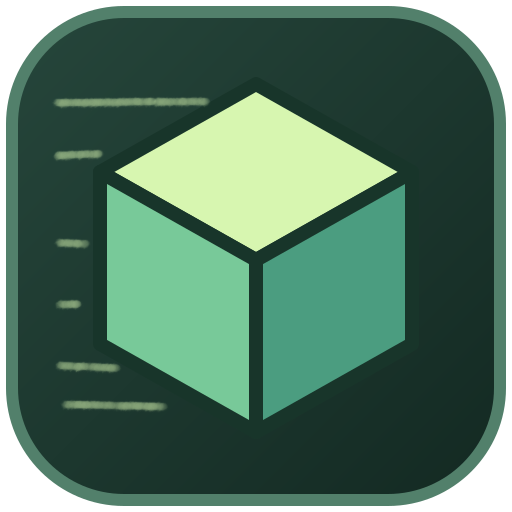
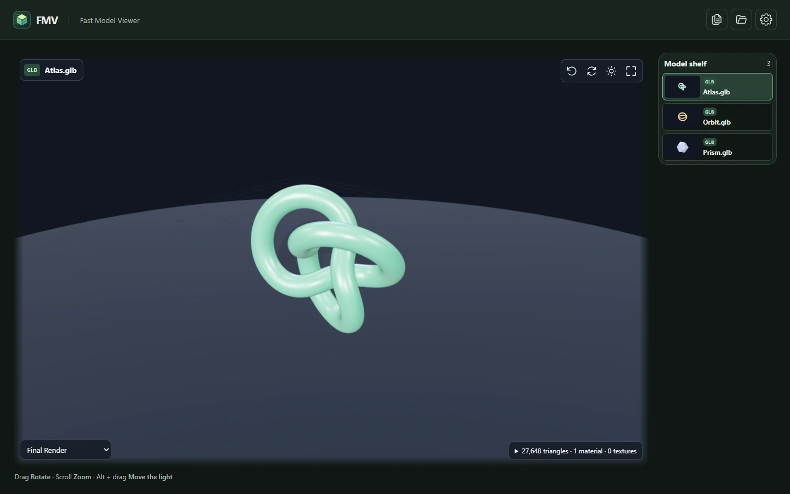

<p align="center">
  
</p>

<h1 align="center">Fast Model Viewer</h1>

<p align="center">Open and inspect local 3D models in a desktop browser or in Electron.</p>

<p align="center">
  <a href="#quick-start">Quick start</a> ·
  <a href="#using-fmv">Using FMV</a> ·
  <a href="#supported-formats">Formats</a> ·
  <a href="#electron-app">Electron app</a>
</p>



## Quick start

Install Git and **Node.js 22.13 or later** with npm. The viewer requires WebGL 2 and is designed for desktop browsers and desktop apps.

```sh
git clone https://github.com/umutokcelik/FMV-FastModelViewer.git
cd FMV-FastModelViewer
npm ci
npm run build
npm link
fmv
```

The `fmv` command starts a server on `127.0.0.1`, picks a free port, and opens your default browser. Press **Ctrl+C** to stop it. Keep the checkout in place so the link installed by `npm link` stays valid.

### macOS

Run the same commands in Terminal. To open a model directly:

```sh
fmv "$HOME/Models/example.glb"
```

If you prefer to run from the checkout without installing a shell command, use `node bin/fmv.mjs` after building. On Windows, `fmv.cmd` also works if PowerShell blocks the npm command shim.

## Using FMV

| Action | Behavior |
| --- | --- |
| Open a file or folder | Use the icons next to Settings, or pass a path such as `fmv "./Models"`. |
| Drop onto the viewer | Replace the current selection with the dropped files or folder. |
| Drop onto the shelf | Add models to the collection and keep the current model in view. The shelf appears while dragging and stays open when the collection contains multiple models. |
| Orbit, zoom, or move the light | Drag to orbit, scroll or pinch to zoom, and use **Alt + drag** to move the light on models that use scene lighting. |
| Inspect a model | Switch between the render, available material channels, wireframe, vertex normals, and the UV checker. |
| Adjust the interface | Change the theme, select English or Turkish, move the shelf, or set the UI scale from 70% to 130%. |

For models with external textures, `.bin` buffers, or `.mtl` files, open the containing folder to keep relative paths intact. Files are read from your computer and served only over loopback when opened through the CLI. The viewer does not fetch remote resources referenced by models.

### Command line

```sh
fmv
fmv "./Models/model.glb"
fmv "./Models"
fmv --no-open "./Models/my scene.gltf"
fmv --help
```

`--no-open` prints the local URL without launching a browser. Use `--` before a path that starts with a dash. Each invocation can run on its own port.

## Supported formats

| Family | Extensions |
| --- | --- |
| glTF and common interchange | `.glb`, `.gltf`, `.obj`, `.fbx`, `.stl`, `.ply`, `.dae`, `.3mf`, `.3ds`, `.amf` |
| USD | `.usd`, `.usda`, `.usdc`, `.usdz` |
| Scene, voxel, and scientific data | `.wrl`, `.vrml`, `.vox`, `.vtk`, `.vtp`, `.pcd`, `.xyz` |

glTF 2.0 and Meshopt compression are supported. Export models without Draco or KTX2 compression. The viewer displays static models and does not play animations.

## Electron app

```sh
npm run desktop     # Build and launch the Electron window
npm run package     # Build an installer for the current platform
npm run package:dir # Build an unpacked application directory
```

Electron uses the same production build as the browser. The packaging configuration targets **NSIS** on Windows, **DMG** on macOS, and **AppImage** on Linux. Run packaging on the target OS. Outputs go to `dist/<version>/`, and local Windows installers are unsigned by default.

## Development

```sh
npm run dev
npm test
```

The Next.js development server uses `http://127.0.0.1:3000`. Run `npm run build` again after changing code used by the CLI or Electron.

| Path | Responsibility |
| --- | --- |
| `app/`, `components/` | Next.js interface, drop targets, and model shelf |
| `lib/viewer/` | Three.js rendering, loaders, and inspection modes |
| `bin/fmv.mjs`, `lib/local-server.mjs` | CLI entry point and loopback server |
| `electron/` | Electron main process and isolated preload |
| `test/` | Viewer, local-file, and server tests |

The original Three.js viewer was adapted from [umutokcelik/candurmaz-portfolio](https://github.com/umutokcelik/candurmaz-portfolio/tree/main/lib/viewer).
